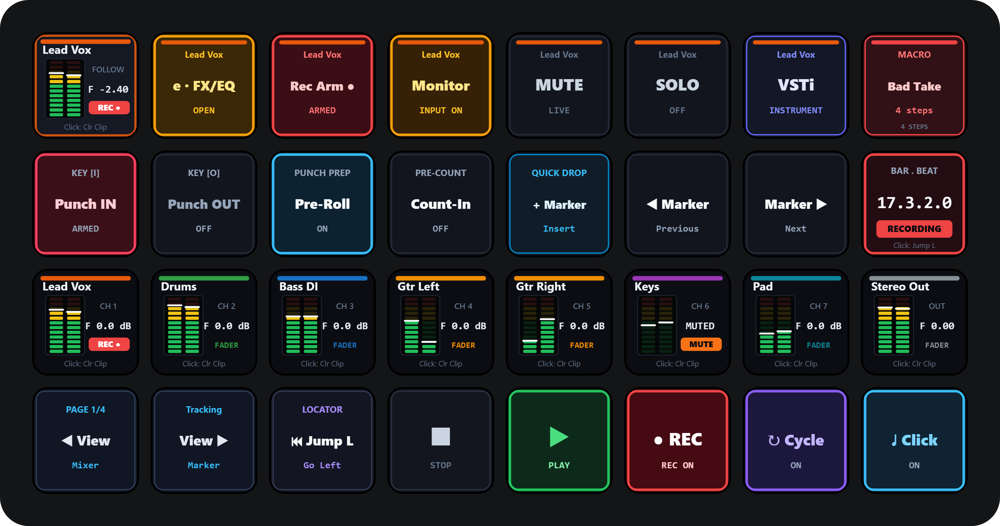

# CubaseBridge — Support

Help, documentation and issue tracking for **CubaseBridge**, the Elgato Stream Deck plugin for bidirectional studio & recording control of Steinberg Cubase 12–15.

> This repository contains documentation and the issue tracker only. The plugin is available on the **Elgato Marketplace**.

---

## Get help

| I want to… | Go to |
|---|---|
| Set up CubaseBridge for the first time | [Installation guide](docs/INSTALLATION.md) |
| Fix something that doesn't work | [Troubleshooting & known quirks](docs/TROUBLESHOOTING.md) |
| Check if my Cubase / Stream Deck / OS is supported | [Compatibility](docs/COMPATIBILITY.md) |
| See what changed | [Changelog](docs/CHANGELOG.md) |
| Ask a question | [Discussions → Q&A](../../discussions) |
| Report a bug | [New issue → Bug report](../../issues/new/choose) |
| Suggest a feature | [New issue → Feature request](../../issues/new/choose) |

**Before opening an issue**, please check the [troubleshooting guide](docs/TROUBLESHOOTING.md) — the two most common setup problems are covered there:
1. **Windows 11:** after creating the loopMIDI ports, quit loopMIDI completely (tray icon → Exit) and start it again.
2. **Cubase:** untick **In 'All MIDI Inputs'** for `Cubase-To-SDXL` in *Studio → Studio Setup → MIDI Port Setup*.

---

## Quick setup

1. Install **CubaseBridge** from the Elgato Marketplace and confirm the profile for your Stream Deck.
2. Create two virtual MIDI ports named exactly `SDXL-To-Cubase` and `Cubase-To-SDXL` (Windows: loopMIDI, macOS: IAC Driver).
3. Open any CubaseBridge key's settings in the Stream Deck app and click **Install / Update Cubase Script**.
4. In Cubase: **Studio → MIDI Remote Manager** → **↻** (Reload Scripts).

Details: [Installation guide](docs/INSTALLATION.md).

---

## Privacy
CubaseBridge runs entirely on your computer and collects no data — see the [privacy statement](docs/PRIVACY.md).
When you post an issue or discussion here, it is **public**: please don't include personal data, private project names or contact details.

---

*Unofficial integration for Steinberg Cubase — not affiliated with, endorsed or sponsored by Steinberg Media Technologies GmbH. Steinberg and Cubase are registered trademarks of Steinberg Media Technologies GmbH. Elgato and Stream Deck are trademarks of Corsair Memory, Inc.*
